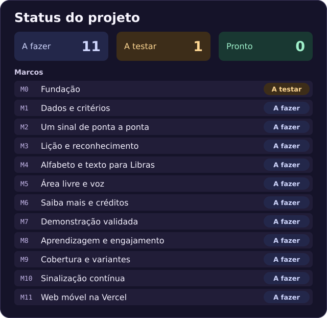

# LibrasIA

O LibrasIA é uma iniciativa educacional sem fins lucrativos, desenvolvida por Luan Fernandes e Wellington Sales. O projeto prevê prática de Libras com webcam e avatar 3D, alfabeto manual e tradução nos dois sentidos.

A primeira demonstração é planejada para PC. O roadmap prevê publicar a mesma aplicação web na Vercel, com acesso pelo navegador em Android e iOS.



[Roadmap e critérios de aceite](ROADMAP_LIBRASIA.md) · [Prompt de implementação](PROMPT_LIBRASIA.md)

## Atualizar o painel

Altere a coluna **Status** do roadmap para **A fazer**, **A testar** ou **Pronto**. Gere o SVG e inclua os dois arquivos no mesmo commit.

```bash
python3 scripts/update_status.py
```

O GitHub Actions verifica se o SVG corresponde ao roadmap. Para rodar a mesma verificação localmente, use `python3 scripts/update_status.py --check`.
